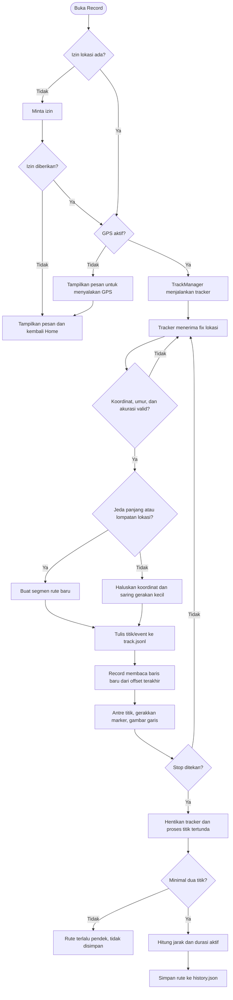

# 🏃 JAGJAG – Health & Fitness Tracker

## 📌 Deskripsi Proyek

JAGJAG adalah aplikasi Android berbasis Python, Kivy, dan KivyMD untuk merekam rute GPS, melihat riwayat perjalanan di peta, menampilkan cuaca BMKG, mengelola profil, serta membuat jadwal pengingat makan.

README ini menjelaskan struktur project dan alur utama agar project lebih mudah dipelajari dan dipresentasikan.

## 🎯 Tujuan Proyek

1. Membantu pengguna merekam dan meninjau aktivitas berjalan/olahraga.
2. Menyediakan informasi profil dan indikator tubuh sederhana.
3. Mendukung kebiasaan harian melalui jadwal pengingat.
4. Memberikan konteks cuaca untuk membantu pengguna merencanakan aktivitas.

## 🚀 Fitur Utama

- **Perekaman rute GPS** secara langsung dengan marker dan garis rute pada peta.
- **Penghitungan aktivitas**, termasuk jarak dan durasi aktif; waktu diam otomatis diperhitungkan sebagai jeda.
- **Riwayat rute** yang disimpan dan dapat dilihat kembali pada halaman peta.
- **Kompas dan mode Heading-up** untuk mengikuti arah perjalanan pada Android.
- **Cuaca BMKG**, mencakup kondisi saat ini dan prakiraan, dengan cache saat koneksi tidak tersedia.
- **Profil pengguna** berupa nama, tanggal lahir, berat, dan tinggi, beserta perhitungan umur dan IMT.
- **Jadwal pengingat makan** dengan beberapa waktu yang diteruskan ke aplikasi alarm Android.

---

## 🛠️ Teknologi yang Digunakan

- Python, Kivy, dan KivyMD untuk logika serta antarmuka.
- Kivy Garden MapView untuk tampilan peta.
- Pyjnius untuk mengakses service lokasi, sensor, alarm, dan API Android.
- Buildozer dan python-for-android untuk membangun APK.
- BMKG API untuk prakiraan cuaca.
- JSON dan JSON Lines untuk penyimpanan lokal.

Konfigurasi Android seperti nama paket, dependensi, izin, arsitektur, dan service terdapat di [`buildozer.spec`](buildozer.spec).

---

## 📂 Struktur Folder

```text
.
├── main.py                         # Titik masuk aplikasi
├── buildozer.spec                  # Konfigurasi build APK
├── extra_manifest_application_arguments.xml
├── assets/                         # Ikon, font, dan gambar splash
├── data/                           # Data contoh/lokal desktop
├── cache/                          # Cache tile peta
└── content/
    ├── _components/                # Komponen bersama, termasuk navbar
    ├── config/                     # Konfigurasi tampilan desktop
    ├── page/
    │   ├── Manager/                # Screen manager dan navigasi
    │   ├── Home/                   # Beranda dan cuaca
    │   ├── Map/                    # Peta riwayat
    │   ├── Record/                 # Perekaman GPS langsung
    │   ├── Time/                   # Jadwal dan alarm
    │   └── Profile/                # Profil dan informasi tubuh
    ├── service/                    # GPS, cuaca, profil, alarm, riwayat
    └── util/                       # Path, inset, dan perhitungan
```

Umumnya setiap halaman memiliki `page.py` untuk perilaku/data dan `page.kv` untuk tampilan. `Manager` memasang semua halaman ke `MDScreenManager`; navbar mengubah screen aktif.

## Alur aplikasi

1. `main.py` memuat konfigurasi dan membuat `MainApp`, turunan `MDApp`.
2. `MainApp.build()` mengatur tema, membaca inset layar, lalu membuat `Manager` sebagai root UI.
3. `Manager` menampilkan lima halaman dan menghubungkan navbar dengan `MDScreenManager`.
4. Di Android, aplikasi meminta izin lokasi dan notifikasi (Android 13 ke atas).
5. Pengguna berpindah antara Home, Map, Record, Time, dan Profile melalui navbar.
6. Jika startup gagal, `main.py` menyimpan traceback ke `crash.log` dan mencoba menampilkan layar error.

## Alur rekaman GPS



Detail: di Android `TrackManager` menjalankan foreground service yang ditentukan di `buildozer.spec`. `tracker.py` mengambil lokasi dari Android, menolak koordinat tidak valid/fix usang/akurasi di atas 25 meter, menghaluskan posisi dan membagi jalur jika ada celah waktu atau lompatan. Titik serta event jeda/lanjut ditulis satu objek JSON per baris. `Record` membaca tambahan file dengan offset, lalu memperbarui marker dan garis. Saat dihentikan, `HistoryManager` membersihkan koordinat, menghitung jarak, durasi aktif, dan menyimpan maksimal 100 rute.

Di desktop, `TrackManager` menjalankan tracker sebagai proses terpisah. `tracker.py` menghasilkan koordinat simulasi di sekitar Bandung; itu bukan lokasi GPS sungguhan.

## Penjelasan setiap halaman

### Home

`content/page/Home/page.py` dan `page.kv` menampilkan cuaca sekarang dan prakiraan. `WeatherManager` mengambil data dari BMKG pada thread terpisah dan menggunakan cache bila jaringan gagal. Saat profil belum tersedia, Home meminta pengguna membuat profil.

### Map

`content/page/Map/page.py` dan `page.kv` memuat rute lewat `HistoryManager`, menggambar segmen dan label tanggal, serta memusatkan peta ke rute terbaru. Rute yang lebih lama digambar lebih transparan.

### Record

`content/page/Record/page.py` dan `page.kv` menampilkan peta langsung, marker, jalur, waktu, koordinat, dan kompas. Halaman ini mengatur mulai/berhenti, memproses data tracker, dan menyimpan aktivitas melalui `HistoryManager`. `CompassManager` membaca sensor arah Android dan dipakai untuk mode Heading-up.

### Time

`content/page/Time/page.py` dan `page.kv` menampilkan jadwal yang tersimpan, memvalidasi nama/frekuensi/jam, lalu meminta `AlarmManager` membuat atau membatalkan alarm berulang melalui aplikasi jam Android. Alarm dilewati di desktop.

### Profile

`content/page/Profile/page.py` dan `page.kv` menampilkan serta mengedit nama, tanggal lahir, berat, dan tinggi. `Profiles` memvalidasi dan menyimpan data; `BodyMath` menghitung umur, IMT, dan kategori sesuai aturan yang tertulis di kode.

## Layanan dan utilitas

| Modul | Tanggung jawab |
|---|---|
| `content/service/track_manager.py` | Izin, status GPS, dan mulai/berhenti tracker Android atau desktop. |
| `content/service/tracker.py` | Pipeline GPS, filter lokasi, segmen, event jeda, dan penulisan log. |
| `content/service/history_manager.py` | Membersihkan rute, menghitung jarak/durasi, menyimpan dan menghapus riwayat. |
| `content/service/weather_manager.py` | Mengambil/mengurai BMKG dan mengelola cache cuaca. |
| `content/service/profile_manager.py` | Membaca, memvalidasi, membuat, dan memperbarui profil. |
| `content/service/alarm_manager.py` | Mengantrekan pembuatan/pembatalan alarm Android. |
| `content/service/compass_manager.py` | Membaca dan menghaluskan heading dari sensor Android. |
| `content/util/paths.py` | Path data, aset, dan file UI; baca/tulis JSON. |
| `content/util/math_location.py` | Validasi koordinat dan perhitungan jarak rute. |
| `content/util/math_body_health.py` | Perhitungan umur, IMT, dan kategori profil. |
| `content/util/insets.py` | Membaca inset status/navigation bar Android. |

## Penyimpanan data

`content/util/paths.py` menaruh data di `ANDROID_PRIVATE/data` pada Android, dan di folder `data/` project pada desktop.

| File | Isi |
|---|---|
| `profiles.json` | Nama, tanggal lahir, berat, dan tinggi. |
| `schedules.json` | Jadwal dan daftar jam alarm. |
| `history.json` | Ringkasan aktivitas, waktu, jarak, titik awal/akhir, serta segmen koordinat. |
| `track.jsonl` | Log append-only, satu baris JSON per titik GPS atau event jeda/lanjut. |
| `weather_cache.json` | Cache cuaca di direktori privat aplikasi. |

Data dalam `data/` repository adalah data lokal/contoh untuk pengembangan. Data aktif Android berada di sandbox privat aplikasi perangkat.

## Menjalankan di desktop

Mode desktop berguna untuk mempelajari tampilan dan alur; lokasi disimulasikan. Alarm, izin Android, service latar belakang, dan sensor kompas tidak sepenuhnya tersedia di desktop.

Contoh PowerShell dari root project (bila Python 3.12 sudah terpasang):

```powershell
python -m venv .venv
.\.venv\Scripts\Activate.ps1
python -m pip install --upgrade pip
python -m pip install kivy==2.3.1 kivymd==2.0.0 kivy-garden.mapview requests pillow
python main.py
```

Pilih Record untuk melihat jalur simulasi. Hentikan rekaman, lalu buka Map untuk melihat rute di riwayat. Jika PowerShell memblokir aktivasi, jalankan `Set-ExecutionPolicy -Scope Process -ExecutionPolicy Bypass` pada jendela tersebut dan ulangi aktivasi. Bila instalasi Kivy gagal, periksa dukungan wheel untuk versi Python yang digunakan.

## Membangun APK Android

Buildozer digunakan di Linux/macOS. Pada Windows gunakan WSL2 + Ubuntu. Salin project ke filesystem Linux (misalnya `~/jagjag`), bukan membangun langsung dari `/mnt/c`; lihat [panduan instalasi resmi Buildozer](https://buildozer.readthedocs.io/en/latest/installation/).

Contoh alur di Ubuntu/WSL2:

```bash
# Dari Ubuntu; sesuaikan path Windows bila folder project berbeda
cp -r "/mnt/c/Morris Tugas Baru/tugas-minggu-3/tugas-minggu-3" ~/jagjag
cd ~/jagjag

python3 -m venv .venv
source .venv/bin/activate
python -m pip install --upgrade pip
python -m pip install buildozer setuptools cython==0.29.34
buildozer -v android debug
```

Pasang dependensi sistem dan Java mengikuti panduan Buildozer untuk versi Ubuntu yang digunakan. Build pertama mengunduh Android SDK/NDK dan komponen lain, sehingga dapat memerlukan beberapa GB ruang serta waktu. Terima lisensi SDK jika diminta. APK debug biasanya muncul di `bin/`. Salin APK ke HP lalu buka untuk memasang; Android mungkin meminta izin instalasi dari sumber tersebut. WSL tidak mengakses USB secara langsung, jadi untuk memakai ADB jalankan dari Windows.

## 👨‍💻 Developer

Nama: Burger Kill

Project:  – Health & Fitness Tracker

Kategori: Health & Fitness Application

Status: Development

Version: 1.0.0

---

## 📄 Lisensi

Proyek ini dibuat untuk tujuan pembelajaran dan
pengembangan aplikasi kesehatan.